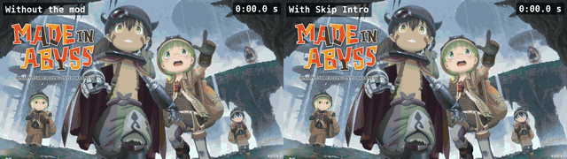
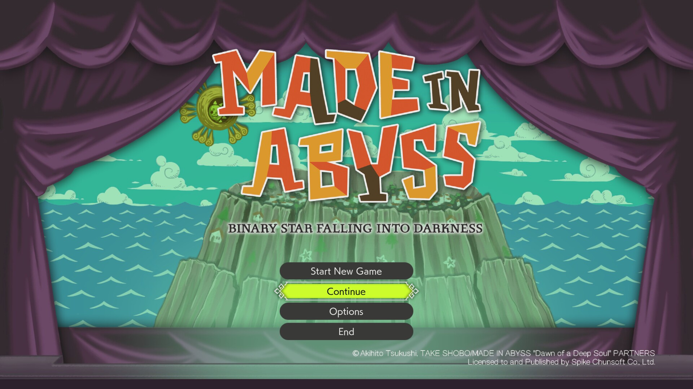

# Skip Intro

A mod for *Made in Abyss: Binary Star Falling into Darkness* (PC, Steam). Skips the startup screens (Spike Chunsoft video, Unreal logo, warning, auto-save notice) and speeds up the title animation: the menu is ready about 3 seconds after the game appears instead of about 34. Saves and settings are not touched.


*Startup without the mod (left, 33.9 s) and with Skip Intro (right, 3.2 s)*


*The title menu, ready about 3 seconds after the game window appears*

[▶ The same comparison as a video](media/startup-compare-web.mp4)

## What it does

The startup screens pass in a moment and the title screen's entrance animation plays quickly, so the menu is ready about 3 seconds after the game window appears instead of about 34. Everything else in the game stays the same.

- The Spike Chunsoft video lasts a fraction of a second.
- The Unreal Engine logo, the warning screen and the auto-save notice pass in a moment.
- The title screen's entrance animation (curtains, logo, menu) plays at 5x speed, without its pauses.
- Saves and settings are not touched.

## Download and install

Download the zip from [latest release](https://github.com/wlady-02/MadeInAbyss-BSFD-SkipIntro/releases/latest), then:

1. In Steam: right click on the game -> Manage -> Browse local files.
2. Extract the zip into that folder; it puts MadeInAbyss-BSFD-SkipIntro_98_P.pak in MadeInAbyss-BSFD\Content\Paks.
3. Or copy MadeInAbyss-BSFD-SkipIntro_98_P.pak into MadeInAbyss-BSFD\Content\Paks by hand.

Works on Windows, Linux (Proton) and Steam Deck (desktop mode).

**Uninstall:** Delete MadeInAbyss-BSFD-SkipIntro_98_P.pak from MadeInAbyss-BSFD\Content\Paks. Saves are not touched.

## Compatibility

- Made for the Steam version, game build 10136809.
- Works with the Italian translation and with UE4SS mods.
- Does not work with other mods that change the startup or title screens.
- Saves and settings are not touched.
- After a game update the mod may stop working: remove it and check for a new version.

## Build it yourself

Requirements:

- Python 3.11 or newer
- the game installed from Steam (the pak is made from its own files)
- GStreamer with gst-launch-1.0 and the openh264enc, voaacenc and mp4mux plugins (for the 0.2 s black video)

From the repository folder:

```sh
python3 run.py build      # build/MadeInAbyss-BSFD-SkipIntro_98_P.pak
python3 run.py release    # build/MadeInAbyss-BSFD-SkipIntro-v<version>.zip
```

## Changes

See [CHANGELOG.md](CHANGELOG.md).

## License

See [LICENSE](LICENSE).

Unofficial, free fan mod, not affiliated with the developers or publishers. Made with the help of an AI (Claude by Anthropic), tested in game by wlady-02.
